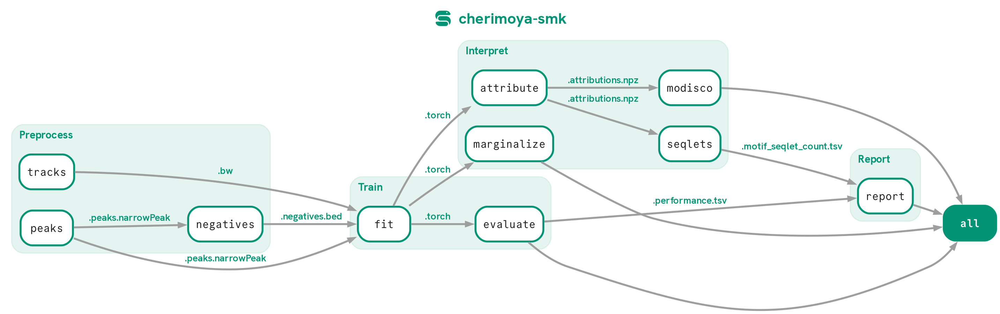

# cherimoya-smk

A Snakemake workflow that trains, evaluates and interprets [cherimoya](https://cherimoya.readthedocs.io) models across many samples.

## Description

cherimoya-smk replaces the orchestration in `cherimoya pipeline` with a file-based DAG. Samples fan out from a sheet, each CV fold is its own job, and only stale outputs rerun. Each stage is a small script in `workflow/scripts/` that calls the cherimoya, tangermeme and modisco libraries, so the model itself stays in the library. A run starts from BAM, fragment or bigWig files. It ends with trained models and their performance tables, DeepLIFT/SHAP attributions, seqlets matched to motifs with TomTom, TF-MoDISco motifs and marginalization reports. Profiles run it on one host or on SLURM.



Each box merges related rules. `tracks` skips bigWig input, and `peaks` runs macs3 when a sample has no peaks. Preprocess runs once per sample, Train and Interpret once per CV fold in `folds`, and Report once per run. The [full rule graph](docs/workflow-snakemake-TB.png) shows every rule.

## Getting Started

### Dependencies

* Linux on x86-64. Both pixi workspaces lock `linux-64` only.
* [pixi](https://pixi.sh) on `PATH`. It installs everything else, including Snakemake, PyTorch and the MEME suite.
* An NVIDIA GPU for `fit`, `evaluate`, `attribute` and `marginalize`. The main env runs on Turing (`sm_75`) and newer, and V100s use the `cherimoya-sm70` env. Without a GPU, set their `device` to `cpu`.
* Per genome, a FASTA with its `.fai` and `chrom.sizes`.

### Installing

```bash
git clone https://github.com/ramirc0/cherimoya-smk.git
cd cherimoya-smk
pixi install
```

This installs the launcher env: Snakemake with its pixi and SLURM plugins. The rule envs install themselves before the first job.

### Executing program

* Copy a config template and the sample sheet template into `config/<run_id>/`, then edit both.
* Write the CV fold files once per genome.
* Dry-run, then run locally or on SLURM.

```bash
mkdir -p config/<run_id>
cp config/config.atac.yaml.template config/<run_id>/config.yaml   # or .dnase / .chipseq-tf
cp config/samples.tsv.template config/<run_id>/samples.tsv
pixi shell
python workflow/scripts/make_folds.py
snakemake -n -p --profile profiles/local --configfile config/<run_id>/config.yaml
snakemake --profile profiles/slurm --configfile config/<run_id>/config.yaml
```

[docs/GETTING_STARTED.md](docs/GETTING_STARTED.md) is the detailed guide: inputs, config templates, references, stage targets, outputs, profiles, environments and tests.

## Help

Dry-run before a real run. It lists every job and why it runs:

```bash
snakemake -n -p --profile profiles/local --configfile config/<run_id>/config.yaml
```

* Put a target such as `train` before `--configfile`, or Snakemake reads it as a config entry.
* If a SLURM job runs out of memory or time, raise its preset in the profile and rerun. Only the failed jobs run again.
* V100s need `--profile profiles/slurm-v100 --config pixi_env=cherimoya-sm70`.
* Each script documents its flags: `python workflow/scripts/<script>.py --help`.

## Authors

Christian Ramirez ([@ramirc0](https://github.com/ramirc0))

## Acknowledgments

Jacob Schreiber wrote cherimoya and the libraries the stages call. The workflow builds on these tools and methods:

Amemiya, Haley M., Anshul Kundaje, and Alan P. Boyle. 2019. “The ENCODE Blacklist: Identification of Problematic Regions of the Genome.” Scientific Reports 9 (1): 9354. https://doi.org/10.1038/s41598-019-45839-z.

Avsec, Žiga, Melanie Weilert, Avanti Shrikumar, et al. 2021. “Base-Resolution Models of Transcription-Factor Binding Reveal Soft Motif Syntax.” Nature Genetics 53 (3): 354–66. https://doi.org/10.1038/s41588-021-00782-6.

Gupta, Shobhit, John A. Stamatoyannopoulos, Timothy L. Bailey, and William Stafford Noble. 2007. “Quantifying Similarity between Motifs.” Genome Biology 8 (2): R24. https://doi.org/10.1186/gb-2007-8-2-r24.

Lundberg, Scott M., and Su-In Lee. 2017. “A Unified Approach to Interpreting Model Predictions.” In Advances in Neural Information Processing Systems 30. https://proceedings.neurips.cc/paper/2017/hash/8a20a8621978632d76c43dfd28b67767-Abstract.html.

Mölder, Felix, Kim Philipp Jablonski, Brice Letcher, et al. 2021. “Sustainable Data Analysis with Snakemake.” F1000Research 10 (January): 33. https://doi.org/10.12688/f1000research.29032.3.

Ovek Baydar, Damla, Ieva Rauluseviciute, Dina R. Aronsen, et al. 2025. “JASPAR 2026: Expansion of Transcription Factor Binding Profiles and Integration of Deep Learning Models.” Nucleic Acids Research 54 (D1): D184–93. https://doi.org/10.1093/nar/gkaf1209.

Pampari, Anusri, Anna Shcherbina, Evgeny Z. Kvon, et al. 2024. “ChromBPNet: Bias Factorized, Base-Resolution Deep Learning Models of Chromatin Accessibility Reveal Cis-Regulatory Sequence Syntax, Transcription Factor Footprints and Regulatory Variants.” Preprint, bioRxiv. https://doi.org/10.1101/2024.12.25.630221.

Schreiber, Jacob. 2025. “Tomtom-Lite: Accelerating Tomtom Enables Large-Scale and Real-Time Motif Similarity Scoring.” Bioinformatics 41 (11): btaf577. https://doi.org/10.1093/bioinformatics/btaf577.

Schreiber, Jacob. 2026. “Tangermeme: A Toolkit for Understanding Cis-Regulatory Logic Using Deep Learning Models.” Nature Methods, ahead of print, October 8. https://doi.org/10.1038/s41592-026-03254-z.

Schreiber, Jacob. n.d. Bpnet-Lite. Github. Accessed October 14, 2026. https://github.com/jmschrei/bpnet-lite.

Schreiber, Jacob. n.d. Cherimoya. Github. Accessed October 14, 2026. https://github.com/jmschrei/cherimoya.

Schreiber, Jacob. n.d. Figwig. Github. Accessed October 14, 2026. https://github.com/jmschrei/figwig.

Shrikumar, Avanti, Peyton Greenside, and Anshul Kundaje. 2017. “Learning Important Features through Propagating Activation Differences.” In Proceedings of the 34th International Conference on Machine Learning, 70:3145–53. PMLR. https://proceedings.mlr.press/v70/shrikumar17a.html.

Shrikumar, Avanti, Katherine Tian, Žiga Avsec, et al. 2018. “Technical Note on Transcription Factor Motif Discovery from Importance Scores (TF-MoDISco) Version 0.5.6.5.” Preprint, arXiv. https://doi.org/10.48550/arXiv.1811.00416.

Zhang, Yong, Tao Liu, Clifford A. Meyer, et al. 2008. “Model-Based Analysis of ChIP-Seq (MACS).” Genome Biology 9 (9): R137. https://doi.org/10.1186/gb-2008-9-9-r137.
